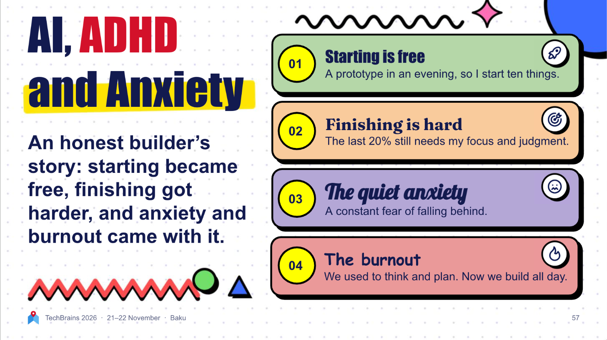
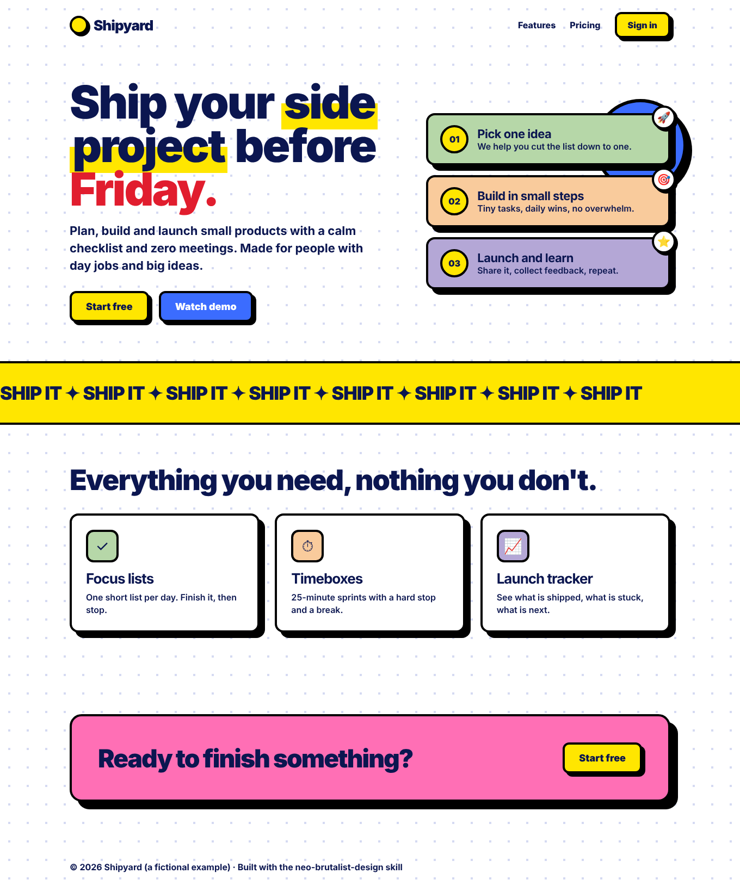
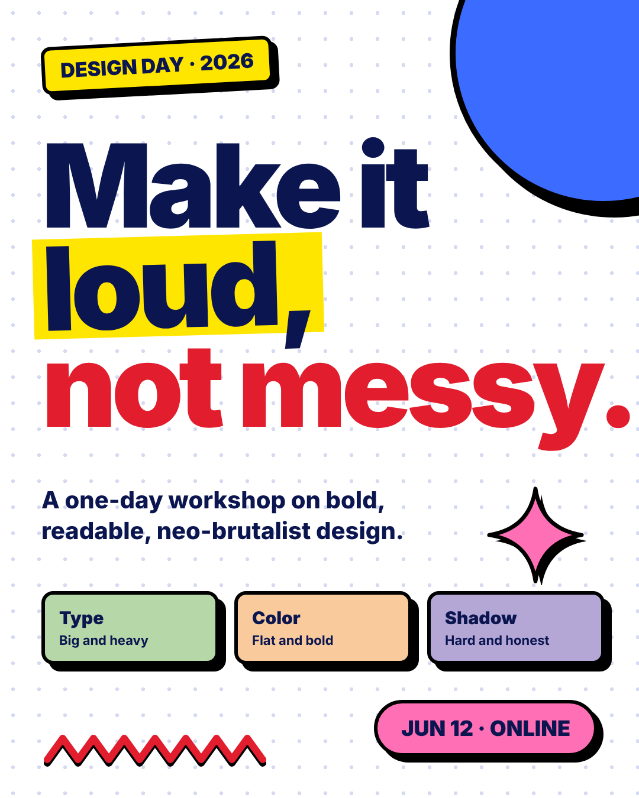
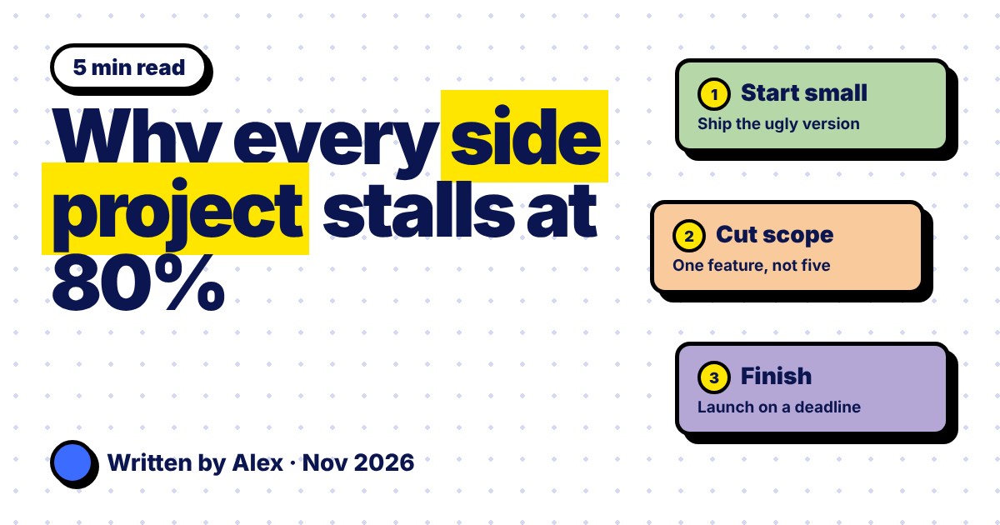

# Neo-Brutalist Design Kit

Skills that teach Claude a bold, modern neo-brutalist design language: thick black borders, hard offset shadows, flat clashing colour, oversized type, icon stickers and playful shapes, while staying readable and professional.

## Gallery

What the style looks like in practice. Every example was made by Claude with these skills.

### Conference talk slide (Google Slides)


### Landing page
Source: [`examples/landing-page.html`](examples/landing-page.html), one self-contained file, open it in any browser.



### Event poster
Source: [`examples/poster.html`](examples/poster.html)



### Social / blog card
Source: [`examples/social-card.html`](examples/social-card.html)



All examples use the same tokens: white dot-grid base, 4px black borders, hard offset shadows, flat pastel cards, yellow badges and marker, one red accent word.

## What's inside

| Skill | Use it for |
| --- | --- |
| `neo-brutalist-design` | A medium-agnostic playbook: principles, colour/type tokens, components, layout recipe, CSS and SVG snippets for websites, posters, social graphics and brand assets. |
| `neo-brutalist-slide-design` | Building a single high-impact slide in Google Slides through Claude in Chrome: rendering SVG art, dropping it in as images or backgrounds, and sizing it precisely. |

## Install

In Claude Code:

```
/plugin marketplace add NasirMustafayev/neo-brutalist-design-kit
/plugin install neo-brutalist-design@neo-brutalist-design-kit
```

Then ask for it by name, for example: "Design a landing page hero in the neo-brutalist style" or "Make my talk slide neo-brutalist".

You can also copy the two `SKILL.md` files under `plugins/neo-brutalist-design/skills/` into your own `~/.claude/skills/<name>/` folders.

## Maintaining

Bump `version` in `plugins/neo-brutalist-design/.claude-plugin/plugin.json` on every release, otherwise users stay on their cached copy. Validate before pushing: `claude plugin validate .`

## Credits

Icons are by [Tabler Icons](https://github.com/tabler/tabler-icons) (MIT). Style inspiration: public neubrutalism write-ups and examples.

## License

MIT, see `LICENSE`.
